<picture><source media="(prefers-color-scheme: dark)" srcset="assets/lang-en-dark.svg"></picture>

<picture>
  <source media="(prefers-reduced-motion: reduce) and (prefers-color-scheme: dark) and (max-width: 600px)" srcset="assets/header-en-static-mobile-dark.svg">
  <source media="(prefers-reduced-motion: reduce) and (max-width: 600px)" srcset="assets/header-en-static-mobile-light.svg">
  <source media="(prefers-reduced-motion: reduce) and (prefers-color-scheme: dark)" srcset="assets/header-en-static-dark.svg">
  <source media="(prefers-reduced-motion: reduce)" srcset="assets/header-en-static-light.svg">
  <source media="(prefers-color-scheme: dark) and (max-width: 600px)" srcset="assets/header-en-mobile-dark.svg">
  <source media="(max-width: 600px)" srcset="assets/header-en-mobile-light.svg">
  <source media="(prefers-color-scheme: dark)" srcset="assets/header-en-dark.svg">
  
</picture>

### About me

I've been building backend applications and distributed systems since 2019. I worked as a lead developer on banking and enterprise projects. My work covered integrations, data models and the transition to event-driven workflows, with a focus on service performance and resilience.

I'm now building a **mass-market messenger for secure, real-time communication**, from Java services to a TypeScript and React interface. My focus is speed and reliability: prompt message delivery, continuous file streaming and connection recovery that keeps conversations going.

I pay particular attention to **call audio quality**, so people can hear each other comfortably. I'm developing a custom system that combines several neural networks to remove noise and pass microphone audio through only while someone is speaking.

### My Open Source Libraries

I build libraries for data processing and reliable distributed applications: model comparison, queries from metadata, background jobs and reactive pipelines, alongside continuous file streaming and browser resources.

Libraries are licensed under MIT.

**[reactive-pipeline-kit](https://github.com/59Alex/reactive-pipeline-kit)** · Java 17+ / Project Reactor · <a href="https://github.com/59Alex/reactive-pipeline-kit/blob/main/LICENSE">MIT</a> 
Composes asynchronous processing steps with bounded concurrency, timeouts and cancellation. Retries apply to the failing step; an optional Jolt adapter transforms JSON records.

**[s3-file-streams](https://github.com/59Alex/s3-file-streams)** · Java / TypeScript · <a href="https://github.com/59Alex/s3-file-streams/blob/main/LICENSE">MIT</a> 
Continuous file streaming between the browser, Java and S3 without buffering the entire file in memory. Backpressure respects the receiver's capacity, and cancellation releases the resources held by a transfer.

**[browser-media-cache](https://github.com/59Alex/browser-media-cache)** · TypeScript · <a href="https://github.com/59Alex/browser-media-cache/blob/main/LICENSE">MIT</a> 
Shares media loads across components with explicit acquire/release ownership. Idle TTL and budgets manage cached Blob URLs; optional CacheStorage and React adapters connect the same lifecycle to persistence and UI.

**[browser-sse-relay](https://github.com/59Alex/browser-sse-relay)** · TypeScript · <a href="https://github.com/59Alex/browser-sse-relay/blob/main/LICENSE">MIT</a> 
SSE reconnection from the last processed event, followed by a transition to the live stream. If the server no longer retains the missed history, the application is signalled to resync its state.

**[pg-task-lease](https://github.com/59Alex/pg-task-lease)** · Java 17+ / PostgreSQL / R2DBC · <a href="https://github.com/59Alex/pg-task-lease/blob/main/LICENSE">MIT</a> 
Coordinates background tasks across workers through expiring leases. Atomic claims, heartbeats and retries support recovery; a stale worker cannot complete a task after losing its lease.

**[relational-paths](https://github.com/59Alex/relational-paths)** · Java 17+ · <a href="https://github.com/59Alex/relational-paths/blob/main/LICENSE">MIT</a> 
Builds explainable JOIN plans from relational metadata. Ambiguous relationships require an explicit choice, so dynamic queries follow the intended data model.

**[model-change-set](https://github.com/59Alex/model-change-set)** · Java 17+ · <a href="https://github.com/59Alex/model-change-set/blob/main/LICENSE">MIT</a> 
Compares model snapshots by stable keys and selected fields. Produces ordered additions, removals and field changes for schema reviews, synchronization and change reports.

<picture><source media="(prefers-color-scheme: dark)" srcset="assets/lang-ru-dark.svg"></picture>

<picture>
  <source media="(prefers-reduced-motion: reduce) and (prefers-color-scheme: dark) and (max-width: 600px)" srcset="assets/header-static-mobile-dark.svg">
  <source media="(prefers-reduced-motion: reduce) and (max-width: 600px)" srcset="assets/header-static-mobile-light.svg">
  <source media="(prefers-reduced-motion: reduce) and (prefers-color-scheme: dark)" srcset="assets/header-static-dark.svg">
  <source media="(prefers-reduced-motion: reduce)" srcset="assets/header-static-light.svg">
  <source media="(prefers-color-scheme: dark) and (max-width: 600px)" srcset="assets/header-mobile-dark.svg">
  <source media="(max-width: 600px)" srcset="assets/header-mobile-light.svg">
  <source media="(prefers-color-scheme: dark)" srcset="assets/header-dark.svg">
  
</picture>

### Обо мне

С 2019 года разрабатываю серверные приложения и распределённые системы. Работал ведущим разработчиком в банковских и корпоративных проектах. Проектировал интеграции и модели данных, переводил бизнес-процессы на событийное взаимодействие. Занимался производительностью и устойчивостью сервисов.

Сейчас разрабатываю **массовый мессенджер для безопасного общения в реальном времени** — от Java-сервисов до интерфейса на TypeScript и React. В центре работы — скорость и надёжность: быстрая доставка сообщений, потоковая передача файлов и восстановление связи, чтобы общение оставалось непрерывным.

Особое внимание уделяю **качеству звука в звонках**, чтобы собеседникам было комфортно слышать друг друга. Для этого разрабатываю собственный механизм на базе нескольких нейросетей: они очищают звук от шума и пропускают сигнал микрофона только во время речи.

### Мои Open Source библиотеки

Разрабатываю библиотеки для обработки данных и надёжных распределённых приложений: сравнения моделей, запросов по метаданным, фоновых задач и реактивных цепочек. Отдельное направление — сквозная передача файлов и работа с ресурсами браузера.

Библиотеки защищены лицензией MIT.

**[reactive-pipeline-kit](https://github.com/59Alex/reactive-pipeline-kit)** · Java 17+ / Project Reactor · <a href="https://github.com/59Alex/reactive-pipeline-kit/blob/main/LICENSE">MIT</a> 
Объединяет асинхронные шаги обработки с ограниченной конкурентностью, тайм-аутами и отменой. Повторяется только сбойный шаг; отдельный адаптер Jolt преобразует JSON-записи.

**[s3-file-streams](https://github.com/59Alex/s3-file-streams)** · Java / TypeScript · <a href="https://github.com/59Alex/s3-file-streams/blob/main/LICENSE">MIT</a> 
Передача файлов сквозным потоком между браузером, Java и S3 без накопления целого файла в памяти. Управление скоростью потока учитывает возможности получателя, а отмена передачи освобождает занятые ресурсы.

**[browser-media-cache](https://github.com/59Alex/browser-media-cache)** · TypeScript · <a href="https://github.com/59Alex/browser-media-cache/blob/main/LICENSE">MIT</a> 
Общая загрузка медиа для нескольких компонентов с явным владением через acquire/release. TTL и бюджеты управляют неиспользуемыми Blob URL; отдельные адаптеры CacheStorage и React связывают этот жизненный цикл с хранилищем и интерфейсом.

**[browser-sse-relay](https://github.com/59Alex/browser-sse-relay)** · TypeScript · <a href="https://github.com/59Alex/browser-sse-relay/blob/main/LICENSE">MIT</a> 
Восстановление SSE-соединения с последнего обработанного события и переход к текущему потоку. Если сервер уже удалил пропущенную историю, приложение получает сигнал заново синхронизировать состояние.

**[pg-task-lease](https://github.com/59Alex/pg-task-lease)** · Java 17+ / PostgreSQL / R2DBC · <a href="https://github.com/59Alex/pg-task-lease/blob/main/LICENSE">MIT</a> 
Распределяет фоновые задачи между воркерами с помощью аренды на ограниченное время. Атомарный захват, продление аренды и повторы помогают восстановить обработку после сбоя; старый воркер не сможет завершить задачу после потери аренды.

**[relational-paths](https://github.com/59Alex/relational-paths)** · Java 17+ · <a href="https://github.com/59Alex/relational-paths/blob/main/LICENSE">MIT</a> 
Строит объяснимый план JOIN по метаданным связей между таблицами. При неоднозначности требует явно выбрать связь, чтобы динамический запрос соответствовал смыслу модели данных.

**[model-change-set](https://github.com/59Alex/model-change-set)** · Java 17+ · <a href="https://github.com/59Alex/model-change-set/blob/main/LICENSE">MIT</a> 
Сравнивает снимки моделей по стабильным ключам и выбранным полям. Возвращает упорядоченные добавления, удаления и изменения полей для проверки схем, синхронизации и отчётов об изменениях.

