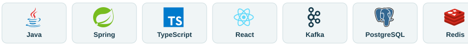

<picture>
  <source media="(prefers-color-scheme: dark) and (max-width: 600px)" srcset="assets/header-mobile-dark.svg">
  <source media="(max-width: 600px)" srcset="assets/header-mobile-light.svg">
  <source media="(prefers-color-scheme: dark)" srcset="assets/header-dark.svg">
  
</picture>

# Aleksandr Kashevarov

**Java Full Stack Developer** · From the browser interaction to the backend transaction.

I build Java services and React applications, with a particular interest in what happens between them: streaming files, delivering events, and keeping state consistent when connections fail.

My work spans Spring APIs, Kafka pipelines, browser media, and containerized infrastructure. I'm now packaging reusable parts of that experience into open-source libraries.

**[Explore the libraries ↓](#building-in-the-open)**

<b>The stack in motion</b> · click to show or hide

 
<a href="#what-i-work-with" title="Explore the technologies">
<picture>
  <source media="(prefers-color-scheme: dark) and (max-width: 600px)" srcset="assets/tech-strip-mobile-dark.svg">
  <source media="(max-width: 600px)" srcset="assets/tech-strip-mobile-light.svg">
  <source media="(prefers-color-scheme: dark)" srcset="assets/tech-strip-dark.svg">
  
</picture>
</a>

### What I work with

**Backend**  
[Java 21](https://dev.java/) · [Spring Boot](https://spring.io/projects/spring-boot) · [WebFlux](https://docs.spring.io/spring-framework/reference/web/webflux.html) · [Kafka](https://kafka.apache.org/) · [PostgreSQL](https://www.postgresql.org/) · [Redis](https://redis.io/)

**Frontend**  
[TypeScript](https://www.typescriptlang.org/) · [React](https://react.dev/) · [Vite](https://vite.dev/) · Browser Streams · Server-Sent Events · WebRTC

**Infrastructure**  
[Docker](https://www.docker.com/) · [Kubernetes](https://kubernetes.io/) · S3-compatible storage · OAuth2 / Keycloak · Observability

### Building in the open

Three libraries, each focused on a problem I've worked with in application code. **Early development:** the repositories currently contain implementation plans and release criteria.

#### [browser-media-cache](https://github.com/59Alex/browser-media-cache)

**TypeScript · Browser infrastructure**  
One media resource, several UI components. Planned shared loading and explicit blob URL ownership keep cleanup predictable as components mount and disappear.

#### [s3-file-streams](https://github.com/59Alex/s3-file-streams)

**Java + TypeScript · Streaming**  
One continuous stream from the browser through Java to S3, and back. Designed around bounded buffering, backpressure, cancellation, and the difference between bytes sent and an object committed.

#### [browser-sse-relay](https://github.com/59Alex/browser-sse-relay)

**TypeScript · Real-time delivery**  
A reconnect is only the first step. Planned cursor replay and a resync contract address events missed while the client was offline.

---

**How I approach engineering**  
I care about where guarantees start, where they stop, and how to demonstrate both with a reproducible test.

Have a use case for one of these libraries? Open an issue in its repository — concrete scenarios help shape the API.
